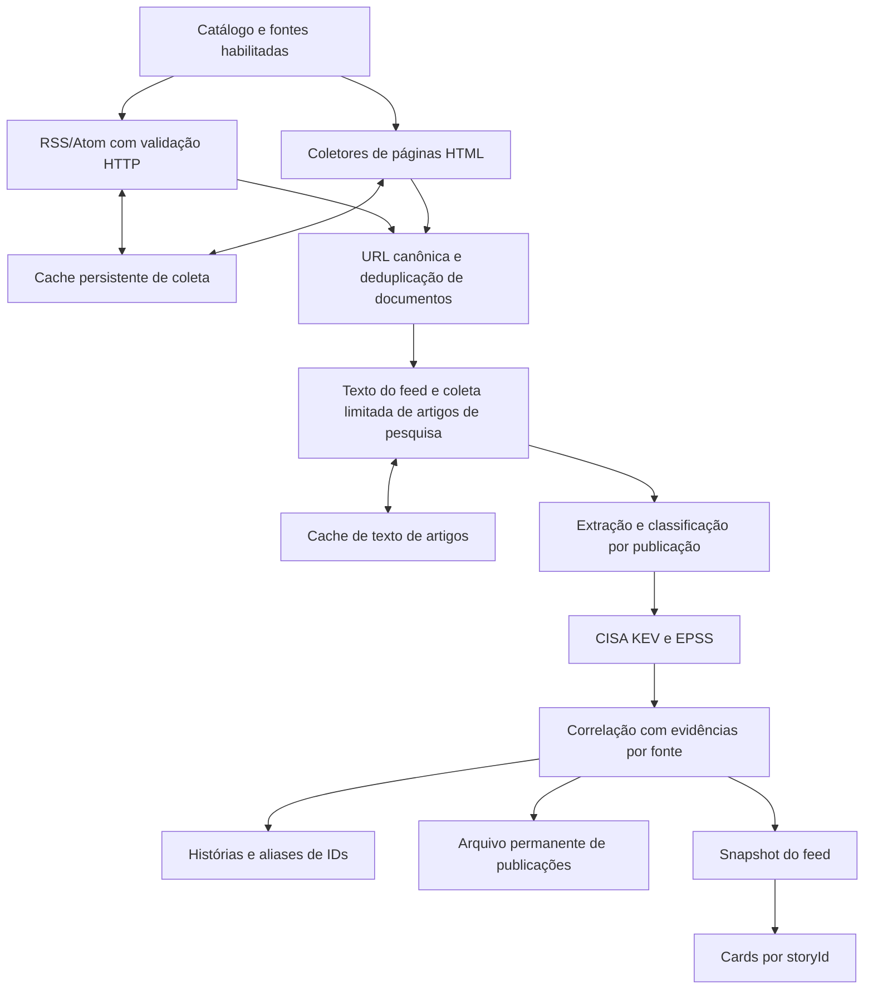

# ETL: coleta e correlação de publicações

O ETL roda no backend Express. Publicação é o documento de uma fonte; história
é o agrupamento de documentos associados ao mesmo assunto. O navegador exibe
um card por `storyId` recebido do backend e não redefine esse agrupamento.



## Coleta

O catálogo RSS fica em `server/ctiIntel.js` (`CTI_FEEDS`). Fontes personalizadas
e desativações ficam em `server/.feed-sources.json`; somente as habilitadas são
buscadas. Coletores de páginas sem RSS ficam em `server/scrapeFeeds.js`.

O ciclo inicia no boot e se repete a cada dez minutos. `singleFlightRefresh`
impede ciclos simultâneos dentro do mesmo processo; uma edição de fonte durante
a coleta agenda mais um ciclo. Não há coordenação entre múltiplos processos.

`server/feedCollector.js` limita concorrência, envia `If-None-Match` e
`If-Modified-Since` quando a fonte forneceu os validadores e reaproveita os itens
no HTTP 304. Falha de rede, resposta inválida ou bloqueio da fonte preserva os
itens válidos da última coleta. Erros ficam associados à fonte em `/api/feeds`.
Os estados são `fresh`, `unchanged`, `stale` e `failed`; o painel de fontes
distingue uma falha com itens em cache de uma coleta bem-sucedida.
Os coletores HTML limitam novos documentos a dez por fonte/ciclo e deixam o
excedente para ciclos seguintes, sem marcá-lo como já coletado. A primeira
listagem de uma fonte sem data confiável apenas estabelece uma linha de base;
fontes com data declarada podem importar publicações já na primeira coleta.
Listagens sem links reconhecidos são tratadas como falha, incluindo páginas de
bloqueio que devolvem HTTP 200.

Há três tentativas para erros transitórios, com esperas de um e três segundos;
cada requisição RSS tem timeout de oito segundos, até três redirecionamentos e
resposta limitada a 8 MB. A concorrência padrão é seis, limitada a dezesseis.
O parser processa até duzentas entradas mais recentes por resposta. Cada fonte
retém até cem publicações dos últimos trinta dias. Esses limites controlam custo
e memória: fontes de volume muito alto podem ter publicações omitidas.

`server/feedParse.js` usa XML para RSS e Atom, entende namespaces, CDATA,
`content:encoded`, links alternativos e URLs relativas. Mantém texto disponível
até vinte mil caracteres, além do resumo de trezentos caracteres. Data ausente,
inválida ou mais de um dia no futuro usa a data da coleta; ciclos seguintes
preservam a primeira data inferida para aquela URL.

A URL canônica remove fragmentos e parâmetros de rastreamento conhecidos,
preservando parâmetros funcionais e maiúsculas no caminho. Não resolve URLs
distintas com conteúdo republicado: isso continua dependendo da correlação.

## Texto e extração

`server/articleCollector.js` complementa notícias e pesquisas (`layer: 2` e `3`)
quando o feed fornece menos de 1.500 caracteres. A presença de IOC não decide
se o texto deve ser coletado: um documento pode trazer atores ou CVEs sem IOCs.
O coletor prioriza publicações recentes e baixa no máximo quarenta corpos por
ciclo, com concorrência três. O HTML é limitado a 2 MB; o texto, a 32 mil
caracteres. Não executa JavaScript para contornar páginas bloqueadas.

Texto de artigo tem cache de 24 horas, invalidado por mudança do título/texto
do feed. Falhas têm janela de nova tentativa de uma hora. Texto anterior do
mesmo conteúdo continua disponível quando a atualização falha ou aguarda o
orçamento do próximo ciclo. Um feed com corpo suficientemente longo dispensa
essa requisição adicional.

`server/feedEnrichment.js` executa classificação e extração depois dessa etapa,
usando título, conteúdo do feed e texto coletado. Cada publicação recebe:

- CVEs, CVSS, indicadores e técnicas MITRE reconhecidas pelas regras existentes;
- atores, famílias de malware e campanhas encontrados nos catálogos de aliases;
- categorias de navegação e sinais usados no score;
- fornecedores/projetos reconhecidos, com ID, nome canônico e alias mencionado;
- `topicCves`, separado de todos os CVEs mencionados, para identificar o foco;
- `contentHash` SHA-256 do texto processado e `extractionVersion: feed-v4`.

A extração prefere o contêiner do corpo do artigo e remove blocos de notícias
relacionadas. Aliases comuns como Action, Play, INC, Expand e Power exigem nome
qualificado de malware; a presença de ransomware na mesma frase não basta.
Campanhas novas explicitamente nomeadas em formato como “campaign dubbed
Midnight Mimosa” recebem ID `reported:...`, distinto de um registro ATT&CK.

O hash identifica o conteúdo processado, não os bytes originais da resposta HTTP.
Depois da extração, CVEs recebem contexto CISA KEV e EPSS. Assim uma CVE
descoberta no corpo do artigo já participa do enriquecimento e da correlação
naquele ciclo. A pontuação combina categorias e sinais estruturais, limitada a
0–100. Score de relevância não é confiança da correlação nem severidade oficial.

As keywords e pesos continuam explícitos em `server/ctiIntel.js`:

| Sinal | Exemplos | Peso da categoria |
| --- | --- | ---: |
| Exploração ativa | zero-day, actively exploited, exploração ativa | 35 |
| Malware | ransomware, backdoor, infostealer | 30 |
| Comprometimento | data breach, vazamento de dados | 25 |
| Técnicas/campanhas | phishing, credential theft, espionage | 20 |
| Grupos | Lazarus, LockBit, UNC seguido de número | 25 |
| Escala | mass exploitation, milhares | 20 |
| Fornecedores/projetos | Microsoft, Fortinet, Cisco, Ivanti, SAP, Veeam, AWS, Siemens e [catálogo ampliado](./vendors.md) | 10 |
| Setores | hospital, governo, fintech | 20 |
| Classes de falha | RCE, authentication bypass, SQL injection | 20 |
| Contexto regional | Brasil, LATAM, domínios brasileiros | 40 |

CVEs acrescentam dez pontos; CVSS alto/crítico acrescenta vinte/trinta; confiança
da fonte acrescenta até vinte; KEV acrescenta vinte e cinco. Keywords de
marketing/carreira recebem penalização quando faltam sinais reais de ameaça.
Contexto regional e nome de fornecedor isolados não desativam essa penalização.
`UNC` dentro de palavras como “function” e “announces” não identifica um grupo.
Fornecedores usam `server/vendorCatalog.js` e `server/vendorMatch.js`. A
categoria soma dez pontos uma única vez por publicação; listar muitos nomes
não multiplica o score. `assets` contém todos os nomes canônicos reconhecidos,
e `vendors` guarda o alias e o setor de cada entidade. Esses campos são menções,
não prova de produto afetado, e não são usados sozinhos para unir histórias.

## Correlação e continuidade dos cards

`server/newsStories.js` compara a publicação recebida com publicações individuais
das histórias existentes. Usa distância de até quatorze dias entre as datas das
publicações; não exige que sejam notícias dos últimos quatorze dias de hoje.
O histórico de histórias retém sessenta dias.

As heurísticas atuais aceitam CVE principal, campanha nomeada, hash, domínio ou
URL de IOC compartilhados como sinais fortes. Ator/malware exige contexto no
título e presença da entidade em pelo menos uma manchete. IP exige dois termos
de contexto. Técnica MITRE nunca identifica um evento nem reduz o limiar.
Similaridade dos termos raros exige dois termos de contexto além dos nomes de
fornecedores; vocabulário genérico de CTI e classes de falha não contam.
Apanhados não unem eventos por entidades, IOCs ou título; uma republicação do
mesmo boletim pelo mesmo veículo/dia pode unir somente a própria edição.
Artigos com CVEs distintas não são unidos apenas por título, ator ou técnica
semelhantes. Campanha nomeada ou IOC forte compartilhado ainda pode demonstrar
um incidente que envolve várias vulnerabilidades.

A comparação não usa a união de evidências de uma história como se cada fonte
as tivesse citado. Evidência herdada de um merge não fabrica a próxima
comparação. Uma publicação nova ainda pode reunir histórias quando encontra
evidência direta em fontes de cada uma delas; isso exige avaliação de qualidade.

Uma URL conhecida é atualizada quando sua extração muda, preservando o ID da
história. A união de histórias guarda IDs absorvidos em `aliases`, consultáveis
pelo endpoint de detalhe. A atribuição de atores/malware também fica por fonte;
a interface de evidências não afirma que todas as fontes citaram uma entidade
presente apenas na união do card.

O frontend prioriza `storyId` sobre agrupamentos antigos por fornecedor/data,
deduplica links dentro do card e substitui sua lista pela resposta atual do
servidor. O cache local foi versionado para descartar IDs do comportamento antigo.
Boletins de kernel também chegam individualmente à correlação no backend.

## Persistência e operação

| Local | Conteúdo | Limite |
| --- | --- | --- |
| `server/.feed-cache/rss/` | Itens parseados, validadores, snapshot do feed | 200 arquivos; 100 itens/fonte, 30 dias |
| `server/.feed-cache/articles/` | Texto de artigos e tentativas | 1.500 arquivos; até 32 mil caracteres/corpo |
| `server/.news-stories.json` | Histórias, evidências por fonte e aliases | 60 dias |
| `server/.news-archive.json` | Metadados das publicações e extração | Sem poda automática |
| `server/.news-monitoring.json` | Fornecedores selecionados por conta | Até 525 IDs/conta |

A seleção de fornecedores filtra a resposta do feed para cada conta, após a
correlação. Basta uma fonte citar um fornecedor selecionado para manter a
cobertura completa disponível do evento. Não altera a coleta compartilhada nem
o score. O deploy preserva essas preferências; o cache do navegador é separado
por conta e seleção. Configuração em **Configurações → Monitoramento**.

O arquivo permanente faz upsert por link, atualiza evidências/categorias e
preserva `archivedAt`. O texto fica nos caches e não é entregue no payload
normal do feed. Os caches não são um arquivo bruto permanente: respostas XML
e HTML originais não são preservadas integralmente, e a poda remove cache antigo.
O snapshot permite servir a última versão após reinício, sinalizada como stale,
até a próxima coleta. Gravações usam arquivo temporário e rename; os diferentes
arquivos do ETL não participam de uma transação única.

O workflow de deploy preserva `.feed-cache/` em envio e rollback. O diretório
está no `.gitignore`. Considere os caches e o arquivo permanente no backup dos
dados da instância. O ciclo registra duração, fontes com falha, publicações e
contagens da coleta de corpos; isso ainda não é um dashboard de métricas.

```dotenv
FEED_FETCH_CONCURRENCY=6
NEWS_IOC_CONCURRENCY=3
NEWS_ARTICLE_MAX_FETCHES=40
```

`NEWS_ARTICLE_MAX_FETCHES=0` desabilita downloads adicionais de corpo; extração
do texto fornecido pelo feed continua funcionando. O orçamento máximo é duzentos.
O nome `NEWS_IOC_CONCURRENCY` foi mantido por compatibilidade de configuração.

Histórias com versão de correlação antiga são reprocessadas automaticamente no
próximo ciclo. A versão atual é `correlationVersion: 3`; a migração usa evidência
por publicação e separa agrupamentos antigos sem copiar sua união de entidades
para cada fonte. IDs/aliases passam a resolver a parte que contém a publicação
de origem. Uma URL atualizada também pode sair de um evento quando muda a
evidência; as fontes restantes são reavaliadas se perderem uma ponte.

Para revisão offline, `node server/rebuildStories.mjs` usa a mesma migração em
dry-run. `--write` guarda `.bak`; pare o serviço antes de escrever e reinicie
depois. Fontes legadas sem texto/atribuição não recuperam fatos do corpo apenas
pelo título; aliases ambíguos antigos são descartados até nova extração.

Falha na correlação/persistência interrompe a publicação do ciclo e mantém o
último feed disponível. O log do ciclo inclui versão, duração da correlação,
eventos, eventos com várias fontes e publicações sem evento. O detalhe da
história retorna `correlationDecisions` com pares, regras e evidências reais,
separado de `correlationEvidence`, que também contém contexto compartilhado.
Uma auditoria offline reproduzível está descrita em [Qualidade da correlação](./correlation-quality.md).

## Limites e próxima etapa

A coleta ficou mais resiliente e a correlação passou a receber mais evidências.
Ainda não há embeddings, extração por LLM, grafo persistente nem correção manual
de merges. Uma CVE ou infraestrutura compartilhada pode aparecer em incidentes
distintos; títulos em idiomas diferentes podem fragmentar o mesmo evento.
Não há garantia de eliminar todos os cards duplicados.

O conjunto inicial usa eventos reais rotulados, medindo fragmentação,
uniões incorretas, cobertura e estabilidade dos IDs. Ele deve crescer com
amostragem aleatória e revisão humana independente. Esse conjunto permite
avaliar contexto de vítima/produto/ação, similaridade semântica e regras de
separação sem trocar duplicação por mistura de incidentes.
