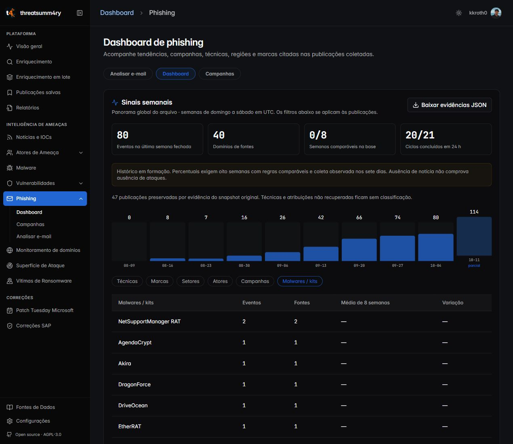

# Phishing: reteste em produção de 15/10/2026

## Correções

- O botão Baixar evidências JSON usa a sessão atual e entrega um arquivo local,
  sem abrir a API em outra aba. Valida a semana e a quantidade de membros antes
  de gerar o download; erros aparecem na própria tela.
- A auditoria falha se a reconstrução das semanas falhar, mesmo quando há um
  snapshot antigo na base. O relatório inclui ciclos e saúde da coleta.
- A tabela de saúde identifica explicitamente até 15 fontes com mais falhas.
- O reteste das dimensões revelou descritores como AI-powered, AiTM e lugares
  tratados como nomes de kits. A regra phishing-kits-v2 exige nomeação explícita ou
  família reconhecida, com regressões para preservar kits novos nomeados.
- O reteste encontrou uma regressão ao trocar a versão de toda a classificação:
  corpos indisponíveis eram reclassificados só por resumos e a semana passou de
  80 para 38 eventos. A revisão final separa a versão dos kits e conserva a
  classificação registrada e seus trechos de evidência. Uma regressão automatizada
  cobre exatamente esse cenário.
- A reclassificação incompleta já havia sido persistida no arquivo. Foi adicionada
  recuperação única de evidências de corpo retidas em eventos/backups, com revisão
  correspondente e cópia do arquivo anterior. Os testes cobrem idempotência,
  rejeição de hash diferente e falha de gravação sem alteração da memória.
- A recuperação de corpo foi parcial. O caminho complementar usa membros dos
  snapshots anteriores à regressão, somente com versão original e hash exato.
  Registra proveniência, mantém técnicas/atribuições desconhecidas vazias e
  sinaliza essa cobertura parcial na interface. Não recupera revisões sem hash.

## Evidências verificadas

O download real no navegador autenticado gerou
`phishing-evidencias-2026-10-04.json`. A leitura local confirmou 85 publicações,
85 membros e 80 IDs distintos de eventos. O painel mostrou 40 domínios de fontes
na semana fechada e 114 eventos na semana parcial de 11/10. A interface de
malwares/kits e o painel de saúde foram conferidos separadamente.

SHA-256 desse arquivo conferido:
`4887ae5a550d2fb7b583eb8ee59af37ed59926f6df5041197b57434567cbc755`.

Após a recuperação final, um novo download pelo mesmo botão confirmou novamente
**85 publicações/membros, 80 eventos e 40 domínios de fontes**, com 47 publicações
preservadas por evidência histórica. A regra exportada é `phishing-kits-v2` e
nenhum dos rótulos AI-powered, AitM, Australia ou Blue permaneceu na dimensão de
malware. SHA-256 do arquivo final:
`035191c84bcddd55f525b6af4ceb05d2c376e6f2f434590c0e30b81f8f3f72fc`.
O console não apresentou erros na conferência final.

## Validação automatizada e release

O [CI 38690061049](https://github.com/kkroth0/thre4th-summary/actions/runs/38690061049)
aprovou 687 testes backend, 242 testes frontend e sete testes de
internacionalização, além de TypeScript e build. Lint sem erros
e com 16 avisos existentes. Os 59 testes direcionados de classificação, dataset,
arquivo e evolução também passaram localmente.
Revisão de código: `74300c94acbecc65cbdef8032491b9caa549e138`.

Deploys finais concluídos:
[VPS 38690225255](https://github.com/kkroth0/thre4th-summary/actions/runs/38690225255)
e [Cloudflare Pages 38690225195](https://github.com/kkroth0/thre4th-summary/actions/runs/38690225195).
A [auditoria final 38690490607](https://github.com/kkroth0/thre4th-summary/actions/runs/38690490607)
também passou após a recuperação.

A auditoria de produção [38687985122](https://github.com/kkroth0/thre4th-summary/actions/runs/38687985122)
reconstruiu dez semanas sem alterar o inventário e confirmou os membros.
Os ciclos observados eram 20 concluídos e um com falha (o erro legado de
campanhas nulas, já corrigido e preservado no histórico). O último ciclo
concluído tinha 264 fontes, 201 saudáveis, 496 corpos em cache, 40 tentativas de
corpo que falharam e 1.139 adiadas. Ciclo concluído não significa todas as
fontes ou todos os corpos disponíveis.

## Limites

A base segue 0/8 semanas comparáveis: arquivo importado não comprova sete dias
de coleta observada. Percentuais permanecem ocultos. O backtest de CT segue sem
amostra suficiente e não permite afirmar precisão ou antecedência. A busca real
no perfil existente não encontrou candidatos; vereditos e vínculos positivos
foram testados com servidor real e dados isolados, sem fabricar casos na conta.

O Continuous Security Scan continua com alertas de dependências anteriores a
esta entrega; nenhum lockfile ou pacote foi alterado. Essa falha é distinta do
CI funcional e dos deploys. A migração integral do arquivo, o stream próprio de
CT e a correlação semântica PT/EN permanecem fora desta primeira etapa.
